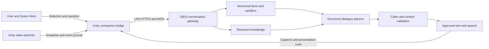

# QIXR quantum companion design

Design proposal, 2026-10-27. Baseline: `test-multiuser`, commit `a0fba5a`. Implementation evidence and source limits are recorded in [the audit](QUANTUM_COMPANION_AUDIT.md).

Implementation update, 2026-10-28: this document preserves the original proposal. Current code, execution evidence and device limitations are in [the implementation record](QUANTUM_COMPANION_IMPLEMENTATION.md); use [the server guide](../server/README.md) for the actual protocol and deployment.

QIXR should let users ask **the quantum system they are manipulating** about its current behavior. The companion, provisionally called **양자 / Quantum**, speaks in the first person, refers to the selected qubit or relationship, and connects an explanation to an inspectable state or event. The existing Unity simulation remains authoritative in the first implementation. This ARM64 GB10 machine serves conversation, numerical interpretation, knowledge retrieval, and speech over the local network.

The immediate deliverable after this design is a text conversation connected to a real Unity snapshot. Voice, character animation, and counterfactual demonstrations follow that verified path.

## 1 Experience and character

Use one companion identity and voice. When a qubit is selected, its halo and label indicate that Quantum is speaking through that qubit. For a pair question, highlight both qubits and their relationship. A separate guide marker can answer questions about the whole system. Avoid assigning independent personalities to entangled qubits in the first version.

The character is curious, patient, concise, and scientifically candid. Start with two or three short sentences, then offer an optional demonstration or deeper explanation. Support Korean and English with an explicit language setting and a small glossary for speech recognition. The core loop is **point or grab → ask → hear and see an explanation → try a related operation**.

| User question | Required context | Intended response behavior |
| --- | --- | --- |
| “왜 네 화살표가 짧아졌어?” | Selected qubit, Bloch radius, global purity, earlier snapshot if available | Explain local mixedness; connect it to entanglement only under an applicable criterion. |
| “너희 둘은 얽혀 있어?” | Explicit pair and its reduced state | Report pair entanglement with numerical tolerance; highlight that pair. |
| “방금 무슨 일이 일어났어?” | Authoritative event with before and after references | Describe the actual gate or measurement, rather than reconstructing an event from appearance. |
| “지금 측정하면 뭐가 나와?” | Measurement basis and current density matrix | Give probabilities; do not secretly measure the live state or predict a random outcome with certainty. |
| “H를 한 번 더 하면?” | Captured state and specified target | Compute on a copy and offer a clearly labeled preview. |
| “줄이 없는데 왜 얽혔다고 해?” | Pair metrics, global state, rendering thresholds | Distinguish pair entanglement, multipartite structure, and visible ribbon thresholds. |

An example approved explanation for a Bell pair is: “내 화살표 길이는 거의 0이야. 우리 둘의 공동 상태는 순수하지만, 나 하나만 보면 측정 결과가 반반으로 보여. 이건 내가 사라졌다는 뜻은 아니야.” This wording requires the corresponding facts; it is not a generic answer for every short Bloch vector.

Personification is an interpretive layer. Quantum does not claim consciousness, intentional collapse, knowledge of future random results, or faster-than-light communication. In scientific explanations, physical entities and their graphics are distinguished: a shrinking graphic is a representation, not a shrinking physical particle. Music is a designed sonification mapping, not the literal sound of a quantum state.

Place character expressions outside the scientific Bloch vector, radius, and ribbon encodings. Listening and speaking animation must not alter those quantities. Use a dedicated talk action or world-space button after checking controller conflicts; X/A already measure and B/Space already expose metrics in existing paths. Begin with push-to-talk, a visible recording indicator, captions, and interruption. Duck the existing arpeggio during speech and restore it afterward. A microphone failure leaves text input available.

## 2 System boundary

| Component | First implementation responsibility |
| --- | --- |
| Unity / Quest or existing PC host | Quantum state, gate/measurement execution, interaction, Fusion replication, rendering, local sonification. |
| Authority bridge | Atomic state capture, stable object IDs, trusted publication, ordered event journal. |
| GB10 gateway | Companion sessions, request cancellation, dialogue context, bounded queues, access control, streaming validated output. |
| Numerical service | Validate density matrices, derive probabilities and metrics, compare states, fork counterfactuals. Never mutate the live scene. |
| Knowledge service | Reviewed concept explanations, paper passages, implementation mappings, stable source IDs. |
| Model and speech workers | Select explanation plans, transcribe questions, synthesize approved sentences. |

For a single user, that user's Unity application is the authority. For a Fusion room, only its state authority publishes canonical experiment data. Each client separately submits its own selection, question, and conversation ID. The AI server initially observes the experiment; it is not a replacement Fusion server or a Quest Link rendering machine.

This boundary also avoids an immediate platform port: the checked-in Linux NanoSockets binary is x86-64, while this host is ARM64. Unity 6.0's ordinary Linux Editor and server support list x64; Embedded Linux is a separate runtime path. A future centralized quantum host would require a deliberate portable-core and transport project, with replay and numerical comparisons before changing authority. See [Unity's platform requirements](https://docs.unity3d.com/6000.0/Documentation/Manual/system-requirements.html).

## 3 State and event contract

Capture the density matrix and its metrics together on the Unity main thread, immediately after an authoritative update. Copy the matrix: `QubitManager.GetDensityMatrix()` exposes a mutable object. Never read Unity objects from a networking worker. Export once per question, after discrete events, and at a bounded background rate, initially 5 Hz. Do not invoke the model for every physics tick.

The wire contract needs these records:

| Record | Required fields |
| --- | --- |
| Snapshot | `schemaVersion`, `roomId`, `authorityEpoch`, `snapshotId`, `stateVersion`, `eventSequence`, `simulationTime`, `capturedAtUtc`, `qubitCount`, `basisOrder`, `densityEncoding`, `density`, `globalPurity`, `validation`, `couplings`, `presentation`. |
| Selection | `participantId`, `conversationId`, `selectionId`, ordered `targetQubitIds`, selection method, capture reference. |
| Event | `eventId`, ordered `sequence`, actor, operation, target IDs, before/after snapshot references, simulation time; basis, outcome and Born probability for measurement. |
| Question | `requestId`, room/conversation/selection IDs, language, text or audio reference, `referenceSnapshotId`, optional `referenceEventId`, `referenceMode`. |
| Answer | Same request/conversation/selection references, `referenceSnapshotId`, status, approved segments, fact/source references, optional presentation cue or sandbox preview. |

Conventions:

- Engine IDs are `0,1,2`; UI names can be `Q1,Q2,Q3`. Send both explicitly. Computational basis order is `|q0 q1 q2>` with q0 as the most significant bit.
- Encode an 8×8 matrix in row-major order as interleaved real and imaginary float64 values. That is 128 numbers, 1,024 bytes before JSON overhead. Mark float32 replica data explicitly if it is used; prefer the authority's float64 capture.
- Bloch components are quantum coordinates, not world-space positions. World transforms, shared-space transforms and display scale are separate presentation fields.
- Local Renyi-2 entropy is in **nats** in the existing code. Logarithmic negativity, mutual information and von Neumann entropy are in **bits**. Use names with unit suffixes in the DTO.
- Coupling strength and simulation time use the current application's simulation conventions, with effectively normalized hbar. Do not label them as calibrated laboratory units.
- Use a monotonically ordered authority epoch across restarts or host replacement. State versions are meaningful only within that epoch. The existing network hash is a synchronization aid, not authentication or an evidence signature.
- Presentation includes active scene, ribbon activation/release thresholds, arpeggio threshold and mapping version, actual visible/playing flags, and current interaction ownership. Derive physical facts from state; explain visibility and sound from presentation data.

At push-to-talk start, lock the selected target. At release, obtain the authoritative reference snapshot; show which target is being addressed. A missing or ambiguous target causes a brief selection request. Do not resolve “너희 둘” by silently choosing an arbitrary neighbor. For “방금,” bind the question to an event ID.

A snapshot supports a state description. Explaining a change requires before/after evidence. Explaining a continuous interaction additionally needs relevant coupling and elapsed-time history; a current proximity value alone cannot establish the cause of a past change. Keep a bounded in-memory journal initially, with configurable expiry and explicit “history unavailable” behavior.

## 4 Scientific facts and answer construction

Separate interpretation from phrasing. The numerical service generates a typed fact bundle from a validated snapshot. The model chooses a response plan containing supported `factIds`, approved explanation blocks, a persona variant, and a possible follow-up or sandbox operation. The gateway resolves those IDs and renders scientific sentences with validated values.

For the MVP, critical scientific sentences use reviewed Korean/English templates. Do not let arbitrary generated prose inherit a “verified” label because a few numbers match. General concept answers use reviewed source blocks; unsupported questions receive a useful scope or uncertainty response. More flexible paraphrasing can be evaluated later with its own error accounting.

Candidate read-only operations are `describe_qubit`, `describe_pair`, `measurement_probabilities`, `explain_event`, `explain_presentation`, and `simulate_on_copy`. Every result names its snapshot or event, calculation version, assumptions, tolerance, and evidence kind: numerical fact, criterion with assumptions, presentation mapping, concept source, or metaphor.

Apply these rules before rendering or TTS:

1. Reject malformed, nonfinite, non-Hermitian, unnormalized or numerically nonphysical states under a stated tolerance. Preserve an unresolved status for boundary cases.
2. Compute Z probabilities from the reduced state. Talking, highlighting, or reading a simulated matrix does not invoke a measurement.
3. A short local Bloch vector or positive local entropy indicates local mixedness. It supports entanglement with the rest when the joint state is pure, with stated numerical assumptions. It does not establish entanglement for an arbitrary mixed global state.
4. For a two-qubit reduced state, use partial transpose and negativity with numerical tolerances. The PPT equivalence applies to this 2×2 case, not arbitrary multipartite dimensions. Near the tolerance, say the value is below numerical resolution. [Horodecki et al.](https://arxiv.org/abs/quant-ph/9605038)
5. Positive mutual information means total correlation; it does not by itself mean entanglement. Pairwise zero negativity does not imply that the three-qubit state is unentangled: GHZ is a necessary counterexample.
6. `HasThreePartyCorrelation` and `ThreePartyCorrelationStrength` are existing heuristics based on local entropy. Do not expose either as a general multipartite-entanglement certificate. A stronger claim needs a separately checked criterion and its assumptions.
7. A missing ribbon or silent arpeggio is not evidence that every form of entanglement is absent. Report the relevant pair, thresholds and mapping. The arpeggio's “relative phase” comes from local Bloch directions; do not call it a general entangled-state phase observable.
8. Local gates and proximity do not always produce entanglement. A measurement record states the measured basis and outcome; later evolution can change the state again. No answer may imply controllable faster-than-light signaling.

There is a simple reason for rule 6. Pure GHZ, its fully dephased classical mixture, and the maximally mixed product state all have local Bloch radius zero and local Renyi-2 entropy ln(2). The current heuristic marks all three. Their global purities are respectively 1, 1/2 and 1/8; the latter two are separable examples. Preserve this distinction even though current closed-system evolution from a pure state may not normally produce those mixtures.

## 5 Time, cancellation and shared rooms

Default to an explanation of the captured question-time state, visibly labeled “질문 당시.” Continuous dynamics advance state versions frequently; strict equality with the latest version would otherwise invalidate almost every answer. Offer a small ghost or detail card for that captured state instead of silently freezing the shared simulation.

An explicitly live question uses a fresh capture and compares the **facts being asserted**, target identity, authority epoch and intervening discrete events. Recompute once if they materially changed. If the system is still changing too quickly, explain the captured state and identify its time rather than repeatedly chasing the latest tick. Thresholds for material change are part of the versioned policy and evaluation.

Before each sentence is displayed or spoken, check its request generation and context binding. A new question, changed target, user interruption, departed room or authority reset cancels obsolete segments. Completed historical answers can remain in a labeled transcript; their highlights must not attach to a new target. Process context-invalidating events before continuing live speech.

Each participant has a separate conversation and request queue, even in a shared experiment. Private questions and answers are private by default. “Explain to everyone” is an explicit shared presentation mode with one room-level speaking queue. An AI failure never pauses the physics loop. Reconnection restores authority and snapshot references before answering about the live scene.

## 6 Counterfactual demonstrations

After state-grounded text works, add a sandbox that forks a snapshot. A user can inspect “apply H to Q1,” “measure Q2 in Z,” or “compare these recorded states.” Give the preview a visible sandbox label and preserve its source snapshot. Enumerate possible measurement outcomes with probabilities; sampling a preview must not be described as a live observation.

Begin with presentation cues and sandbox operations only. A later “apply to the experiment” button submits an allowlisted request through the existing Unity authority, with target, expected epoch/version, permissions and idempotency key. The authority validates and executes it, and returns an event acknowledgement. A proposed action is never described as executed before that acknowledgement.

Do not add an arbitrary Python, shell or Unity-code execution tool to the companion. GHZ/W fixtures are useful reference previews, but fixture injection must not masquerade as a sequence already supported by the current four-gate user interface. A whole-room pause, if later added, is a separate explicit host interaction.

## 7 Server deployment on this machine

Observed host: Ubuntu 24.04.5, ARM64, 20 CPU cores, NVIDIA GB10, approximately 121 GiB OS-visible memory, driver 580.178.04. These observations do not establish model compatibility or latency.

Use a small Python gateway with FastAPI/Pydantic, an independent numerical module, and adapters for model, ASR and TTS workers. Begin with an in-process queue and SQLite for optional structured session/replay records. A reviewed, versioned local knowledge collection is sufficient initially; retrieval complexity should follow actual content volume. Keep matrices and arithmetic outside model prompts and supply the compact fact bundle instead.

| Service | Initial candidate and decision rule |
| --- | --- |
| Local language model | CUDA-enabled `llama.cpp` using an ARM64/GB10 build recipe. Compare a multilingual quantized 8–14B candidate with the NVIDIA recipe's larger MoE example only if needed; choose by factual task success and measured latency, not memory capacity alone. [NVIDIA recipe](https://build.nvidia.com/spark/llama-cpp/overview) |
| ASR | `whisper.cpp` multilingual checkpoint; verify Korean/English quantum vocabulary and ARM64/CUDA build. [Project](https://github.com/ggml-org/whisper.cpp) |
| TTS | Evaluate MeloTTS as a Korean/English candidate after checking weight licenses, ARM64 dependencies, pronunciation and interruption. Captions remain the fallback. [Project](https://github.com/myshell-ai/MeloTTS) |
| Numerical reference | NumPy/SciPy in a project environment for independent small-matrix calculations. Compare against the existing C# engine before claiming agreement. |

A replaceable remote model adapter can be added if local quality or latency is inadequate, with an explicit data-routing setting. Local service is the initial assumption, not an already measured capability. No model download, installation or serving process is part of this design delivery.

Publish one authenticated LAN gateway, using HTTPS/WSS for device access; keep inference worker ports on loopback or an internal container network. Pair clients with short-lived room-scoped credentials and distinguish authority publishers from questioners. Bound audio length, payload size, queue depth and GPU concurrency; start with one generation at a time and measure 1/2/4-client workloads. Do not accept authoritative snapshots from an arbitrary questioner. Raw audio is transient by default; retain transcripts or replay records only through an explicit session setting.

Proposed endpoints:

- `GET /healthz` and `GET /readyz`: process health versus loaded/ready dependencies.
- `POST /v1/rooms`: create a room and authority enrollment credentials.
- `POST /v1/rooms/{roomId}/snapshots` and `/events`: authority publication, ordered and idempotent.
- `POST /v1/rooms/{roomId}/conversations`: participant-scoped conversation.
- `WS /v1/conversations/{conversationId}/stream`: question/audio input, transcript, validated answer segments, audio chunks, preview cues, status and cancellation.

WebSocket messages carry `protocolVersion`, `type`, `requestId`, `generation`, `sequence`, and room/conversation context. Audio-start metadata states codec, channels and sample rate; binary chunks bind to that request. Begin with mono PCM16 at 16 kHz input and a bounded push-to-talk utterance. TTS announces its output format separately. Queue saturation returns a visible busy state and bounded retry; unsupported protocol versions fail explicitly. Stream approved sentences, never unchecked model tokens.

## 8 Implementation sequence and completion evidence

The following paths are proposed additions; they do not exist yet.

| Phase | Concrete work | Completion evidence |
| --- | --- | --- |
| 1 State-grounded text | `Assets/Scripts/Companion/QuantumContextExporter.cs`, `QuantumEventJournal.cs`, `QuantumCompanionClient.cs`; `server/qixr_companion/{api,contracts,facts,dialogue}`; versioned explanation blocks and replay fixtures. | A selected real scene qubit can answer about its captured state, measurement probabilities and a recorded event, with captions and traceable fact IDs. |
| 2 Voice and presence | Dedicated talk input, ASR/TTS adapters, `QuantumCompanionPresenter.cs`, captions, speaking halo, audio ducking, interruption. | One complete headset voice turn; actual end-to-end and cancellation timing recorded. |
| 3 Sandbox | State-copy operations and `QuantumDemoPreview.cs`, with a distinct preview presentation. | Preview matches reference calculation and leaves live state/version unchanged. |
| 4 Shared-room operation | Authority bridge, participant isolation, shared speaking mode, reconnection and authority reset handling. | Two real clients share the same experiment while conversations, selected targets and interruptions remain correctly scoped. |
| 5 Deployment and evaluation | ARM64 pinned builds/images, restart configuration, bounded workloads, replay evaluation and report. | Measured quality/latency on this host; reproducible launch path; relevant Unity and Quest regressions. |

In phase 1, first export one known state and answer “what is my Z-measurement probability?” without a model. Next add the structured dialogue planner. This isolates numerical and transport errors from model behavior. Reuse the existing H/X/Z/S operations and metric checks; do not upgrade Unity or replace sonification as part of this work. Fixture setup must account for `QubitManager` automatically applying an initial X gate after 0.5 seconds when enabled.

Start a compact benchmark with 20 development trajectories and 40 held-out trajectories, three question types each. Keep a trajectory and all its paraphrases in one split. Use product, Bell-plus-spectator, GHZ, W, classically correlated mixtures, fully mixed product states, near-threshold states, gate/measurement histories, and stale/missing/invalid-context cases. Analytic mixtures belong to reference fixtures even if the default scene does not generate them. Korean/English variants test language robustness and are not independent scientific samples.

Compare the same model/persona and output budget in three conditions: static knowledge; knowledge plus raw snapshot context; verified facts plus the proposed response policy. Measure scientific claim correctness and answer coverage together, target/event binding, probability/metric error, inappropriate certainty, invalid-state handling, cancellation, and live-state mutation. A persona ablation can check technical correctness, but it cannot establish engagement or learning.

Proposed engineering acceptance criteria are zero critical unsupported entanglement claims, wrong-target deliveries, or unintended mutations in the held-out cases; at least 95% correct supported state-specific answers among answerable cases, with abstentions included in the denominator; and explicit coverage/error reporting for unsupported cases. No finite zero-error result is a universal guarantee. Set numerical thresholds separately for authority float64 and network float32, starting from existing 1e-7 engine checks and calibrating serialization tolerances with round trips.

Measure p50/p95 latency from push-to-talk release to approved captions and first audible speech, including state capture, ASR, queueing, inference, validation and TTS. Initial design targets for short turns with one active speaker are p95 below 2 seconds for captions and below 3 seconds for first speech, with local playback interruption below 200 ms. These are goals, not observations; revise model size or staging if the measured pipeline misses them. Report room concurrency and queue rejection rates alongside latency. Headless checks cannot establish headset frame rate, speech comfort or user learning.

## 9 Research question and contribution boundary

Proposed question: **Can a personified quantum companion give accurate, contextually bound explanations during manipulation of a shared quantum simulation, including cases where local appearance and global entanglement differ?**

Embodied/personality-driven LLM agents already exist, including [Sonlu et al., IEEE VR 2025](https://www.cs.bilkent.edu.tr/~gudukbay/publications/papers/conf_papers/Sonlu_et_al_IEEE_VR_2025.pdf). Quantum education assistants also exist, including the [ITAS preprint](https://arxiv.org/abs/2604.24807). Adjacent work includes [guard-mediated LLM/VR scene control](https://www.mdpi.com/2076-3417/16/17/8591). Neither adding speech nor adding stale-result guards alone establishes novelty.

The candidate contribution is a quantum-specific interaction and evidence mechanism: selected-object dialogue bound to a joint state and event history, explicit mixedness/entanglement distinctions, presentation-aware explanations, and inspectable counterfactuals. Its value must survive the stated comparisons and a closer related-work review. The first research claim can concern correctness, contextual consistency and system behavior without a new user study. Claims about improved intuition, engagement or learning require separate human evidence; the original QIXR study cannot establish the benefit of this new companion.

The recommended next implementation is phase 1, beginning with the authoritative snapshot DTO, event journal and deterministic probability explanation.
